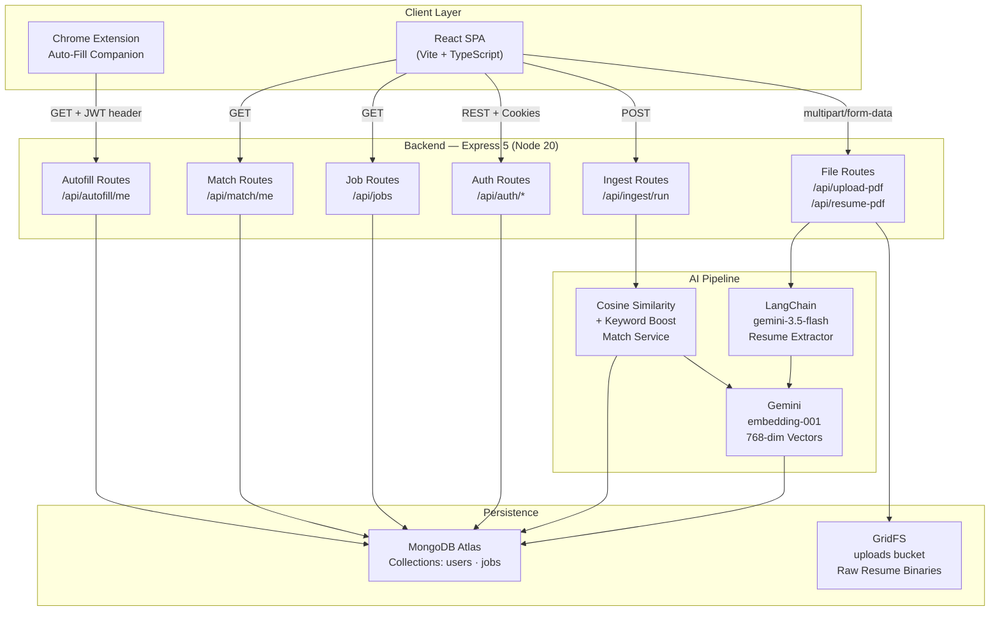
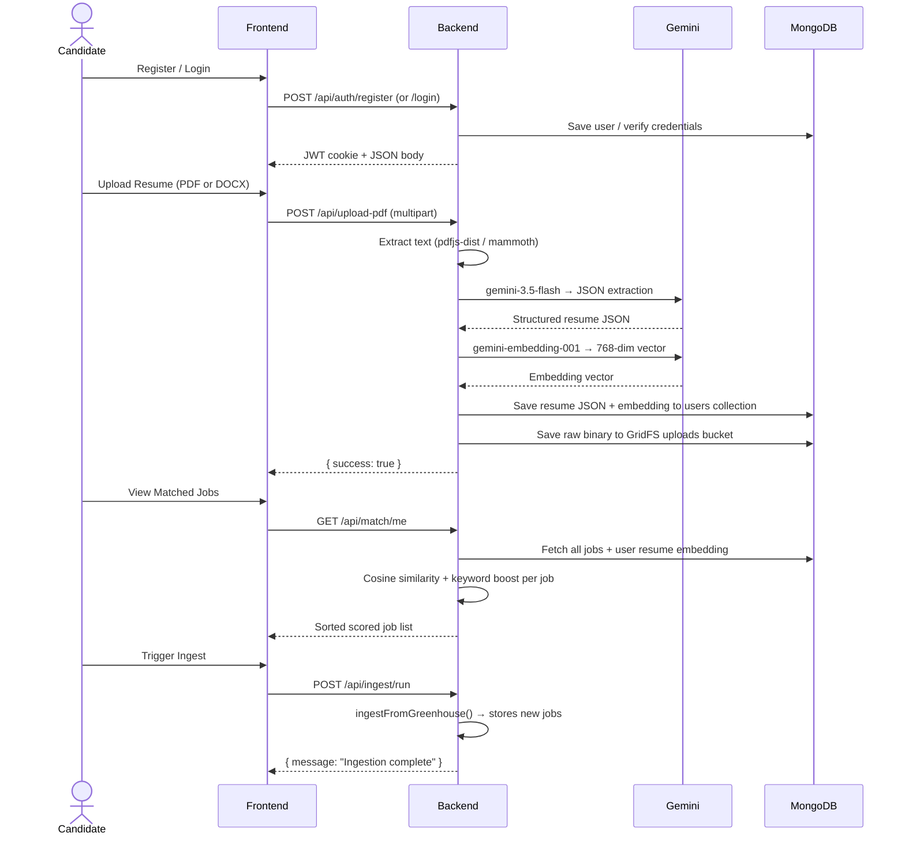
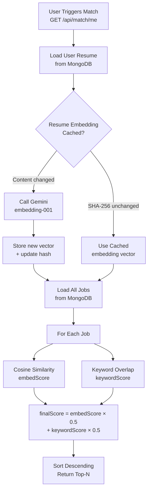
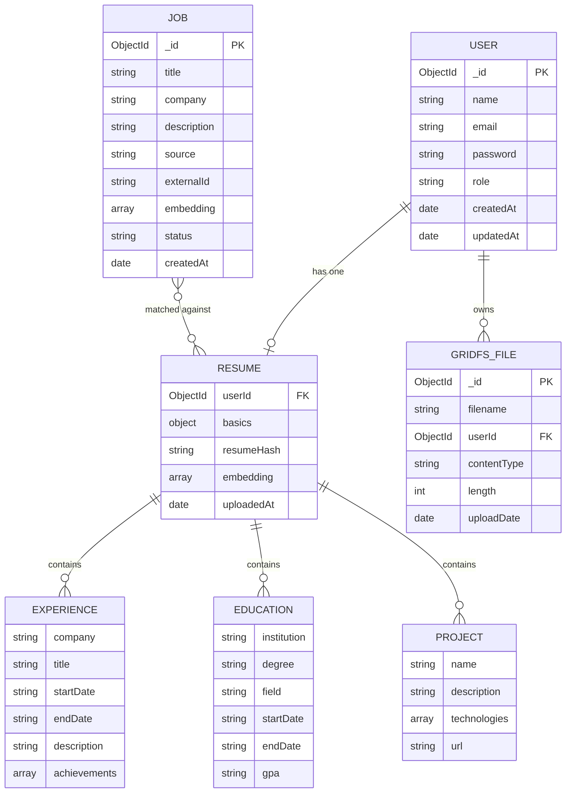
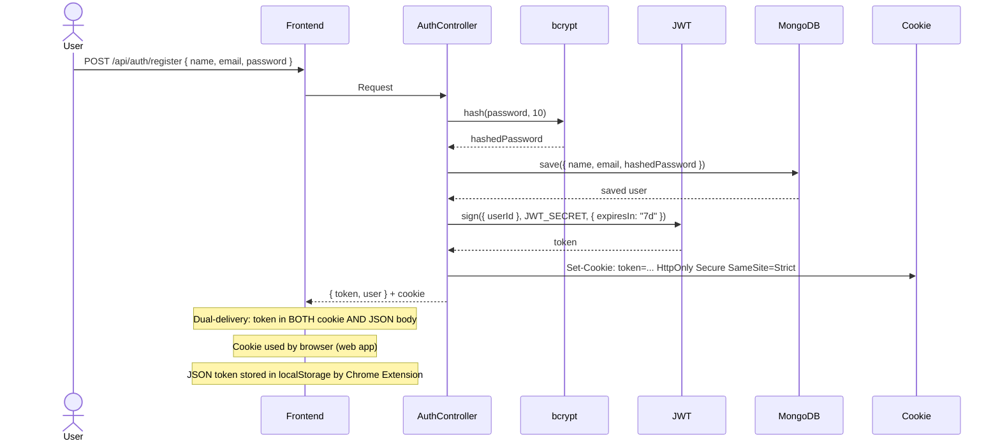

# AutoJobApply — AI-Powered Job Matching & Auto-Fill Platform


---

## Table of Contents

1. [Executive Summary](#1-executive-summary)
2. [High-Level Architecture Diagram](#2-high-level-architecture-diagram)
3. [Component Breakdown](#3-component-breakdown)
   - [3.1 Backend API Layer](#31-backend-api-layer)
   - [3.2 AI Matching Engine](#32-ai-matching-engine)
   - [3.3 Resume Intelligence Pipeline](#33-resume-intelligence-pipeline)
   - [3.4 Frontend Application](#34-frontend-application)
   - [3.5 Chrome Extension Companion](#35-chrome-extension-companion)
4. [Application Workflow](#4-application-workflow)
5. [AI Matching Engine — Deep Dive](#5-ai-matching-engine--deep-dive)
6. [Data Models & Schemas](#6-data-models--schemas)
7. [Authentication Architecture](#7-authentication-architecture)
8. [API Reference](#8-api-reference)
9. [Developer Setup & Local Development](#9-developer-setup--local-development)
10. [Environment Variables Reference](#10-environment-variables-reference)
11. [Deployment — Render](#11-deployment--render)
12. [Security Considerations](#12-security-considerations)
13. [Performance Considerations](#13-performance-considerations)
14. [Known Bugs & Roadmap](#14-known-bugs--roadmap)
15. [Contributing Guide](#15-contributing-guide)
16. [License](#16-license)

---

## 1. Executive Summary

**AutoJobApply** is a full-stack, AI-powered job application platform that eliminates manual job hunting. Candidates upload their resume (PDF or DOCX), which is parsed and structured by Google Gemini. A vector embedding pipeline then scores every scraped job listing against the candidate's profile using a composite similarity formula. A companion Chrome Extension reads the structured profile from the backend and auto-fills ATS job forms in one click.

| Dimension | Detail |
|---|---|
| **Deployment Model** | Single-domain: Express serves React SPA + JSON API on the same origin |
| **AI Models** | `gemini-embedding-001` (768-dim vectors) + `gemini-3.5-flash` (structured extraction) |
| **Resume Parsing** | PDF via `pdfjs-dist` (legacy, with Promise.withResolvers polyfill) · DOCX via `mammoth` |
| **Storage** | MongoDB Atlas · GridFS for raw resume binaries |
| **Auth** | JWT (7-day expiry) · bcrypt (salt 10) · HttpOnly cookies + JSON body dual-delivery |
| **Application Tracking** | Kanban board — 6 statuses: Applied, Pending, Interview, Accepted, Rejected, Archived |
| **Design System** | YC color palette — Orange `#F26522`, Background `#F7F7F5`, Text `#171717` |
| **Chrome Extension** | [Auto-Apply Companion](https://github.com/rajkushwaha-01/Auto-Job-Apply-chrome-extension) |

---

## 2. High-Level Architecture Diagram



---

## 3. Component Breakdown

### 3.1 Backend API Layer

| Property | Value |
|---|---|
| **Entry Point** | `Backend/server.js` |
| **Framework** | Express 5 |
| **Runtime** | Node.js 20.x (pinned via `"engines"` in `package.json`) |
| **Port** | `process.env.PORT` → fallback `3000` |
| **SPA Fallback** | `express.static('Frontend/dist')` + wildcard `*` returns `index.html` |
| **Middleware** | `cors`, `cookie-parser`, `express.json()` |
| **Promise Polyfill** | `Promise.withResolvers` shim injected at the very top of `server.js` (required for Node < 22 + `pdfjs-dist`) |

**Registered Route Modules:**

| Prefix | File | Responsibility |
|---|---|---|
| `/api/auth` | `authRoutes.js` | Register, login, logout, getMe |
| `/api` | `fileRoutes.js` | PDF/DOCX upload, resume retrieval |
| `/api` | `jobRoutes.js` | Paginated job listing, single job detail |
| `/api` | `matchRoutes.js` | Scored job list for authenticated user |
| `/api/ingest` | `ingestRoutes.js` | Trigger job ingestion pipeline |
| `/api` | `autofill.routes.js` | Flat profile payload for Chrome Extension |

**Key Backend Dependencies:**

| Package | Version | Purpose |
|---|---|---|
| `express` | ^5.x | HTTP framework |
| `mongoose` | ^8.x | MongoDB ODM + GridFS |
| `@langchain/google-genai` | latest | LangChain Google Gemini integration |
| `@google/generative-ai` | latest | Gemini SDK (embeddings) |
| `pdfjs-dist` | legacy build | PDF text extraction |
| `mammoth` | ^1.x | DOCX text extraction |
| `multer` | ^1.x | Multipart file upload |
| `bcryptjs` | ^2.x | Password hashing (salt 10) |
| `jsonwebtoken` | ^9.x | JWT signing / verification |
| `cookie-parser` | ^1.x | HttpOnly cookie parsing |
| `cors` | ^2.x | Cross-origin resource sharing |

---

### 3.2 AI Matching Engine

| Property | Value |
|---|---|
| **Location** | `Backend/src/services/match.service.js` |
| **Embedding Model** | `gemini-embedding-001` · 768-dimensional vectors |
| **Scoring Formula** | `finalScore = embedScore × 0.5 + keywordScore × 0.5` |
| **Embedding Caching** | SHA-256 hash of resume text; skip regeneration if unchanged |
| **Rate Limit Handling** | Exponential backoff: `15s × attemptNumber` |
| **Top-N Return** | Returns top-scored jobs sorted descending by `finalScore` |

---

### 3.3 Resume Intelligence Pipeline

| Property | Value |
|---|---|
| **Location** | `Backend/src/services/ai.service.js` |
| **LLM** | `gemini-3.5-flash` via LangChain `ChatGoogleGenerativeAI` |
| **Prompt** | Structured JSON schema extraction prompt (`Backend/src/Prompt/aiExtract.js`) |
| **PDF Parser** | `pdfjs-dist` (legacy build) with `Promise.withResolvers` polyfill |
| **DOCX Parser** | `mammoth` |
| **Storage** | Extracted JSON persisted into `users.resume` subdocument · raw binary into GridFS `uploads` bucket |
| **Controller** | `Backend/src/controllers/file.Controller.js` |

**Extracted Resume Fields (from Gemini JSON schema):**

| Field | Type |
|---|---|
| `basics` | name, email, phone, location, linkedin, github, website, summary |
| `experience[]` | company, title, startDate, endDate, description, achievements[] |
| `education[]` | institution, degree, field, startDate, endDate, gpa |
| `projects[]` | name, description, technologies[], url |
| `certifications[]` | name, issuer, date, url |
| `skills` | raw string list |
| `skillsByCategory` | `Record<string, string[]>` — category → skill array |
| `languages[]` | language, proficiency |
| `awards[]` | title, issuer, date, description |
| `volunteer[]` | organization, role, startDate, endDate, description |
| `publications[]` | title, publisher, date, url |

---

### 3.4 Frontend Application

| Property | Value |
|---|---|
| **Framework** | React 18 + TypeScript 5 |
| **Bundler** | Vite 5 |
| **Styling** | Tailwind CSS 3 |
| **Routing** | React Router v6 |
| **State** | Local component state + React Query (server state) |
| **Build Output** | `Frontend/dist/` — served by Express in production |

**Route Map (`Frontend/src/App.tsx`):**

| Path | Component | Description |
|---|---|---|
| `/` | `LandingPage` | Hero, features, CTAs |
| `/login` | `LoginPage` | JWT login form |
| `/register` | `RegisterPage` | Account creation |
| `/dashboard` | `DashboardPage` | Overview metrics |
| `/profile` | `ProfilePage` | Parsed resume display + edit |
| `/jobs` | `JobsPage` | Matched jobs list |
| `/applications` | `ApplicationsPage` | 6-status Kanban board |
| `/automation` | `AutomationPage` | Job preference config + ingest trigger |

**Key Frontend Dependencies:**

| Package | Purpose |
|---|---|
| `react-router-dom` | Client-side routing |
| `@tanstack/react-query` | Server-state caching |
| `axios` | HTTP client |
| `lucide-react` | Icon library |
| `tailwindcss` | Utility-first CSS |
| `@types/react` | TypeScript definitions |

---

### 3.5 Chrome Extension Companion

| Property | Value |
|---|---|
| **Repository** | [Auto-Job-Apply-chrome-extension](https://github.com/rajkushwaha-01/Auto-Job-Apply-chrome-extension) |
| **Purpose** | One-click ATS form auto-fill using live backend profile data |
| **Auth** | Reads JWT from `localStorage` → sends as `Authorization: Bearer <token>` header |
| **Data Source** | `GET /api/autofill/me` → flat profile JSON |
| **Target** | Any ATS job application form in the active Chrome tab |

**Autofill payload fields (from `/api/autofill/me`):**

| Field | Source |
|---|---|
| `firstName` / `lastName` | `resume.basics.name` |
| `email` | `resume.basics.email` |
| `phone` | `resume.basics.phone` |
| `linkedin` | `resume.basics.linkedin` |
| `github` | `resume.basics.github` |
| `location` | `resume.basics.location` |
| `skills` | `resume.skills` (array) |
| `education` | First education entry |
| `latestExperience` | Most recent experience entry |
| `summary` | `resume.basics.summary` |

---

## 4. Application Workflow



---

## 5. AI Matching Engine — Deep Dive

### Scoring Pipeline



### Scoring Formula

**Embedding Score (cosine similarity):**

$$\text{embedScore} = \frac{\vec{u} \cdot \vec{j}}{|\vec{u}|\ |\vec{j}|}$$

where $\vec{u}$ = user resume embedding (768-dim), $\vec{j}$ = job description embedding (768-dim).

**Keyword Score:**

$$\text{keywordScore} = \frac{|\text{matched\_skills}|}{\min(|\text{total\_skills}|,\ 8)}$$

**Composite Final Score:**

$$\text{finalScore} = 0.5 \times \text{embedScore} + 0.5 \times \text{keywordScore}$$

### Embedding Cache

| Mechanism | Detail |
|---|---|
| **Cache key** | SHA-256 hash of full resume text |
| **Storage** | Stored alongside embedding in `users` document |
| **Invalidation** | On next match request, hash is recomputed and compared; mismatch triggers re-embed |
| **Benefit** | Avoids redundant Gemini API calls; reduces latency + cost |

### Rate Limit Backoff

```
Retry attempt N → wait 15s × N before next API call
```

Implemented with async sleep inside embedding service retry loop.

---

## 6. Data Models & Schemas

### Entity-Relationship Diagram



### User Collection — Field Reference

| Field | Type | Required | Description |
|---|---|---|---|
| `name` | String | ✅ | Full display name |
| `email` | String | ✅ | Unique; used for login |
| `password` | String | ✅ | bcrypt hash (salt 10) |
| `role` | String | — | Default: `"user"` |
| `resume` | Subdocument | — | Full parsed resume object (see below) |
| `resume.basics` | Object | — | name, email, phone, linkedin, github, location, summary |
| `resume.experience` | Array | — | Work history entries |
| `resume.education` | Array | — | Academic records |
| `resume.projects` | Array | — | Portfolio projects |
| `resume.certifications` | Array | — | Professional certifications |
| `resume.skills` | Array | — | Flat skill list |
| `resume.skillsByCategory` | Object | — | `{ category: string[] }` map |
| `resume.languages` | Array | — | Spoken languages + proficiency |
| `resume.awards` | Array | — | Honors and awards |
| `resume.volunteer` | Array | — | Volunteer experiences |
| `resume.publications` | Array | — | Published works |
| `resume.embedding` | Array[768] | — | Gemini embedding-001 vector |
| `resume.resumeHash` | String | — | SHA-256 hash of resume text for cache invalidation |
| `resume.uploadedAt` | Date | — | Timestamp of last resume upload |
| `createdAt` | Date | auto | Mongoose timestamps |
| `updatedAt` | Date | auto | Mongoose timestamps |

### Job Collection — Field Reference

| Field | Type | Required | Description |
|---|---|---|---|
| `title` | String | ✅ | Job title |
| `company` | String | ✅ | Employer name |
| `description` | String | ✅ | Full JD text (used for embedding) |
| `source` | String | — | Origin platform (e.g., `"greenhouse"`) |
| `externalId` | String | — | Platform's native job ID (dedup key) |
| `embedding` | Array[768] | — | Pre-computed Gemini embedding for this JD |
| `status` | String | — | `"active"` \| `"expired"` |
| `location` | String | — | Job location string |
| `url` | String | — | Direct application URL |
| `createdAt` | Date | auto | Mongoose timestamps |

---

## 7. Authentication Architecture



**Token Delivery Strategy:**

| Consumer | Token Location | Reason |
|---|---|---|
| Web App (React) | HttpOnly Cookie (auto-sent) | XSS protection |
| Chrome Extension | `Authorization: Bearer <token>` header (from `localStorage`) | Extensions cannot read HttpOnly cookies across domains |

**Protected Route Middleware:**

Requests to protected routes require the JWT token in either:
1. `req.cookies.token` (web app), or
2. `Authorization: Bearer <token>` header (Chrome Extension)

---

## 8. API Reference

### Auth Routes — `/api/auth`

| Method | Path | Auth | Body / Params | Response |
|---|---|---|---|---|
| `POST` | `/api/auth/register` | ❌ | `{ name, email, password }` | `{ token, user }` + cookie |
| `POST` | `/api/auth/login` | ❌ | `{ email, password }` | `{ token, user }` + cookie |
| `POST` | `/api/auth/logout` | ✅ | — | Clears cookie |
| `GET` | `/api/auth/me` | ✅ | — | `{ user }` |

<details>
<summary>POST /api/auth/register — Example</summary>

**Request:**
```json
{
  "name": "Raj Kushwaha",
  "email": "raj@example.com",
  "password": "SecurePass123!"
}
```

**Response `200`:**
```json
{
  "token": "eyJhbGciOiJIUzI1NiJ9...",
  "user": {
    "_id": "64abc...",
    "name": "Raj Kushwaha",
    "email": "raj@example.com"
  }
}
```
</details>

---

### File Routes — `/api`

| Method | Path | Auth | Body | Response |
|---|---|---|---|---|
| `POST` | `/api/upload-pdf` | ✅ | `multipart/form-data` — field: `resume` (PDF or DOCX) | `{ success: true, message }` |
| `GET` | `/api/resume-pdf` | ✅ | — | GridFS binary stream (PDF) |

<details>
<summary>POST /api/upload-pdf — Flow</summary>

1. Multer receives file → stores in memory buffer
2. Text extracted: `.pdf` → pdfjs-dist (legacy) · `.docx` → mammoth
3. Text sent to `gemini-3.5-flash` via LangChain → structured JSON
4. JSON + 768-dim embedding saved to `users.resume`
5. Raw binary saved to GridFS `uploads` bucket
6. `Promise.withResolvers` polyfill required (see [Known Bugs](#14-known-bugs--roadmap))

**Response `200`:**
```json
{
  "success": true,
  "message": "Resume uploaded and parsed successfully"
}
```
</details>

---

### Job Routes — `/api/jobs`

| Method | Path | Auth | Params | Response |
|---|---|---|---|---|
| `GET` | `/api/jobs` | ✅ | `?page=1&limit=20` | `{ jobs[], total, page }` |
| `GET` | `/api/jobs/:id` | ✅ | `id` — MongoDB ObjectId | `{ job }` |

---

### Match Routes — `/api/match`

| Method | Path | Auth | Description |
|---|---|---|---|
| `GET` | `/api/match/me` | ✅ | Returns jobs scored and sorted by AI match against logged-in user's resume |

<details>
<summary>GET /api/match/me — Response Example</summary>

```json
{
  "matches": [
    {
      "_id": "64abc...",
      "title": "Frontend Engineer",
      "company": "Acme Corp",
      "finalScore": 0.87,
      "embedScore": 0.91,
      "keywordScore": 0.83,
      "url": "https://jobs.greenhouse.io/acme/frontend"
    }
  ]
}
```
</details>

---

### Ingest Routes — `/api/ingest`

| Method | Path | Auth | Description |
|---|---|---|---|
| `POST` | `/api/ingest/run` | ✅ | Triggers `ingestFromGreenhouse()` to scrape + store new job listings |

> <!-- TODO: ingest.service.js currently only re-exports `findMatchesForUser`. Full Greenhouse/Lever/Adzuna ingestion pipeline details are unclear — the actual scraping logic may live in an external module or be incomplete. Verify before advertising multi-board support. -->

---

### Autofill Routes — `/api/autofill`

| Method | Path | Auth | Description |
|---|---|---|---|
| `GET` | `/api/autofill/me` | ✅ (Bearer) | Returns flat profile JSON for Chrome Extension |

<details>
<summary>GET /api/autofill/me — Response Example</summary>

```json
{
  "firstName": "Raj",
  "lastName": "Kushwaha",
  "email": "raj@example.com",
  "phone": "+91-9876543210",
  "linkedin": "https://linkedin.com/in/raj",
  "github": "https://github.com/rajkushwaha-01",
  "location": "India",
  "skills": ["React", "Node.js", "Python"],
  "education": {
    "institution": "IIT Example",
    "degree": "B.Tech",
    "field": "Computer Science"
  },
  "latestExperience": {
    "company": "TechCorp",
    "title": "SDE-1",
    "description": "Built scalable microservices..."
  },
  "summary": "Passionate full-stack developer..."
}
```
</details>

---

## 9. Developer Setup & Local Development

### Prerequisites

| Tool | Minimum Version | Notes |
|---|---|---|
| Node.js | 20.x | Match Render production version |
| npm | 10.x | Bundled with Node 20 |
| MongoDB | Atlas cluster or local | Need connection URI |
| Google Cloud | — | Gemini API key with `generativelanguage.googleapis.com` enabled |
| Git | any | — |

### Step-by-Step Setup

**1. Clone the repository**
```bash
git clone https://github.com/rajkushwaha-01/AUTO-JOB-APPLY.git
cd AUTO-JOB-APPLY
```

**2. Install all dependencies**
```bash
npm install
npm --prefix Backend install
npm --prefix Frontend install
```

**3. Configure environment variables**

Create `Backend/.env`:
```env
MONGO_URI=mongodb+srv://<user>:<password>@cluster.mongodb.net/autojobapply
JWT_SECRET=your_jwt_secret_minimum_32_chars
GEMINI_API_KEY=your_google_gemini_api_key
NODE_ENV=development
PORT=3000
PUPPETEER_SKIP_DOWNLOAD=true
```

**4. Build the frontend**
```bash
npm --prefix Frontend run build
```

**5. Start the backend (serves both API + SPA)**
```bash
npm --prefix Backend run dev
# or for production mode:
npm start
```

**6. Open in browser**
```
http://localhost:3000
```

**7. Install the Chrome Extension (optional)**
- Clone [Auto-Job-Apply-chrome-extension](https://github.com/rajkushwaha-01/Auto-Job-Apply-chrome-extension)
- Open `chrome://extensions` → Enable Developer Mode → Load Unpacked → select extension folder
- Log in to the web app first so the JWT lands in `localStorage`

---

## 10. Environment Variables Reference

### Backend (`Backend/.env`)

| Variable | Description | Required | Default |
|---|---|---|---|
| `MONGO_URI` | MongoDB Atlas connection string | ✅ | — |
| `JWT_SECRET` | Secret key for JWT signing (min 32 chars) | ✅ | — |
| `GEMINI_API_KEY` | Google Gemini API key | ✅ | — |
| `GEMINI_MODEL` | Override default LLM model name | ❌ | `gemini-3.5-flash` |
| `NODE_ENV` | Runtime environment | ❌ | `development` |
| `PORT` | HTTP server port | ❌ | `3000` |
| `PUPPETEER_SKIP_DOWNLOAD` | Prevent Chromium download on install | ❌ | — |

### Root `package.json` Build Scripts

| Script | Command | Description |
|---|---|---|
| `build` | `npm --prefix Backend install --include=dev && npm --prefix Frontend install && npm --prefix Frontend run build` | Full production build |
| `start` | `node Backend/server.js` | Start production server |

---

## 11. Deployment — Render

### Render Blueprint (`render.yaml`)

The repository includes a `render.yaml` for one-click deployment:

```yaml
services:
  - type: web
    name: auto-job-apply
    runtime: node
    region: oregon
    buildCommand: npm install && npm run build
    startCommand: npm start
    envVars:
      - key: MONGO_URI
        sync: false
      - key: JWT_SECRET
        sync: false
      - key: GEMINI_API_KEY
        sync: false
      - key: PUPPETEER_SKIP_DOWNLOAD
        value: "true"
      - key: NODE_ENV
        value: production
```

### Manual Deploy Steps

| Step | Action |
|---|---|
| 1 | Fork/push repository to GitHub |
| 2 | In Render Dashboard → New Web Service → Connect GitHub repo |
| 3 | Set Root Directory to `/` (repo root) |
| 4 | Build Command: `npm install && npm run build` |
| 5 | Start Command: `npm start` |
| 6 | Add all environment variables from [§10](#10-environment-variables-reference) |
| 7 | Deploy |

### Important Render Notes

> [!IMPORTANT]
> - Set `PUPPETEER_SKIP_DOWNLOAD=true` to avoid Chromium download during build (Puppeteer is listed as a dependency but cloud autofill is replaced by the Chrome Extension in production).
> - `NODE_ENV=production` causes npm to skip devDependencies — the build command uses `--include=dev` to ensure TypeScript types are present during Vite build.
> - Node 20.x is pinned in root `package.json` under `"engines"`. Render respects this field.

---

## 12. Security Considerations

| Area | Implementation | Status | Known Gap |
|---|---|---|---|
| **Password Storage** | bcrypt, salt factor 10 | ✅ Secure | — |
| **JWT Expiry** | 7 days | ⚠️ Long-lived | No refresh token rotation; compromised tokens remain valid for up to 7 days |
| **Token Delivery (Web)** | HttpOnly Cookie — inaccessible to JavaScript | ✅ XSS-safe | — |
| **Token Delivery (Extension)** | `localStorage` — accessible to JS in extension context | ⚠️ Extension-scoped risk | Extension content scripts must be audited for XSS |
| **CORS** | `cors` middleware enabled | ⚠️ Check config | Verify allowed origins are not `*` in production |
| **Input Validation** | Basic `express.json()` body parsing | ⚠️ Partial | No schema-level validation (e.g., Zod/Joi) on request bodies |
| **File Upload** | Multer — memory storage | ⚠️ Memory risk | No file size limit enforced; large PDFs could exhaust server memory |
| **MongoDB Injection** | Mongoose ODM with typed schemas | ✅ Protected | — |
| **Environment Secrets** | Loaded via `process.env`, never committed | ✅ Secure | Ensure `.env` is in `.gitignore` |
| **HTTPS** | Enforced by Render (TLS termination) | ✅ Production | HTTP only in local dev |
| **Rate Limiting** | None on API routes | ❌ Missing | Brute-force login attacks are unmitigated; add `express-rate-limit` |
| **Helmet.js** | Not configured | ❌ Missing | No HTTP security headers (CSP, HSTS, X-Frame-Options) |

<!-- TODO: Add express-rate-limit to /api/auth/login and /api/auth/register -->
<!-- TODO: Add multer file size limit (e.g., 10 MB max) in file.Controller.js -->
<!-- TODO: Configure helmet.js in app.js for production HTTP security headers -->
<!-- TODO: Add Zod or Joi request body validation on all POST endpoints -->

---

## 13. Performance Considerations

| Consideration | Detail |
|---|---|
| **Embedding Cache** | SHA-256 hash prevents redundant Gemini API calls; matching stays fast after first embed |
| **Gemini Rate Limits** | Retry logic with 15s × attempt backoff prevents 429 errors from blocking pipeline |
| **GridFS Streaming** | Raw PDFs streamed from MongoDB GridFS — avoids loading entire binary into application memory on retrieval |
| **SPA Static Assets** | React SPA served from `Frontend/dist` via `express.static` — files cached by browser with ETag |
| **Vite Build** | Tree-shaking + code splitting in Vite 5 reduces frontend bundle size |
| **MongoDB Indexes** | <!-- TODO: Confirm indexes on `users.email`, `jobs.externalId`, `jobs.source` for query performance --> |
| **Node.js Version** | Pinned to Node 20 LTS — avoids unexpected runtime differences between local and Render |

---

## 14. Known Bugs & Roadmap

### Known Bugs

| ID | Component | Description | Root Cause | Fix |
|---|---|---|---|---|
| BUG-001 | Backend / pdfjs | `TypeError: Promise.withResolvers is not a function` on Node < 22 | `pdfjs-dist` uses ES2024 `Promise.withResolvers`; Node 20 doesn't have it natively | Polyfill injected at top of `server.js` and `file.Controller.js` |
| BUG-002 | Frontend / tsconfig | `TS5102: 'baseUrl' has been removed` on Render (Node 26 TS) | Newer TypeScript removed `baseUrl` option | Removed `baseUrl`, replaced paths with `"@/*": ["./src/*"]` |
| BUG-003 | Frontend / build | `TS7026: JSX element implicitly has type 'any'` in production build | `NODE_ENV=production` skips devDependencies, missing `@types/react` | Moved types to `dependencies`; added `--include=dev` to build command |
| BUG-004 | Frontend / ProfilePage | `TS2339: Property 'length' does not exist on type '{}'` | `skillsByCategory` inferred as `{}` type | Added explicit cast: `const skillsByCategory: Record<string, string[]>` |
| BUG-005 | Backend / Ingest | `POST /api/ingest/run` calls `ingestFromGreenhouse()` but service may not implement full pipeline | `ingest.service.js` currently only re-exports `findMatchesForUser` | <!-- TODO: Implement or wire actual Greenhouse/job-board scraping logic --> |
| BUG-006 | Backend / Autofill | `autofill.service.js` uses Puppeteer with `headless: false` | Headless:false Puppeteer won't work in cloud (no display server) | Chrome Extension replaces server-side autofill for production; Puppeteer path unused in cloud |

### Planned Features / Roadmap

| Priority | Feature | Status |
|---|---|---|
| 🔴 High | Full Greenhouse / Lever / Adzuna job ingestion pipeline | 🚧 Partial |
| 🔴 High | JWT refresh token rotation (short-lived access + long-lived refresh) | ❌ Planned |
| 🔴 High | API rate limiting (`express-rate-limit`) on auth routes | ❌ Planned |
| 🟡 Medium | `helmet.js` HTTP security headers | ❌ Planned |
| 🟡 Medium | File upload size limit (10 MB max) in Multer config | ❌ Planned |
| 🟡 Medium | Zod/Joi schema validation on all API request bodies | ❌ Planned |
| 🟡 Medium | Email notifications on match score above threshold | ❌ Planned |
| 🟢 Low | Application analytics dashboard (apply rate, interview rate) | ❌ Planned |
| 🟢 Low | Multi-resume support (switch active resume without re-uploading) | ❌ Planned |
| 🟢 Low | Direct Apply via Extension (not just autofill — full form submit) | ❌ Planned |
| 🟢 Low | Dark mode toggle in frontend | ❌ Planned |

---

## 15. Contributing Guide

### Branch Naming Convention

| Type | Pattern | Example |
|---|---|---|
| Feature | `feat/<short-description>` | `feat/refresh-token-rotation` |
| Bug fix | `fix/<issue-or-short-desc>` | `fix/multer-size-limit` |
| Docs | `docs/<what-changed>` | `docs/api-reference-update` |
| Chore | `chore/<task>` | `chore/upgrade-express-5` |
| Refactor | `refactor/<area>` | `refactor/match-service-caching` |

### Commit Message Convention (Conventional Commits)

```
<type>(<scope>): <short description>

[optional body]

[optional footer — e.g., Closes #42]
```

**Types:** `feat` · `fix` · `docs` · `chore` · `refactor` · `test` · `style` · `perf`

**Examples:**
```
feat(auth): add JWT refresh token rotation
fix(backend): add Promise.withResolvers polyfill for Node 20 pdfjs compat
docs(readme): add FrontendForge-style numbered sections
chore(deps): move @types/react to dependencies for Render build
```

### Pull Request Checklist

Before opening a PR, verify:

- [ ] Branch follows naming convention
- [ ] Commit messages follow Conventional Commits
- [ ] No new TypeScript errors (`tsc --noEmit` in `Frontend/`)
- [ ] Backend starts cleanly (`node Backend/server.js`)
- [ ] Frontend builds without errors (`npm --prefix Frontend run build`)
- [ ] No secrets or `.env` files committed
- [ ] `README.md` updated if API surface or env vars changed
- [ ] TODO comments added for any incomplete work

### Development Workflow

```bash
# 1. Fork and clone
git clone https://github.com/YOUR_USERNAME/AUTO-JOB-APPLY.git

# 2. Create feature branch
git checkout -b feat/your-feature

# 3. Make changes and test locally
# ... (see §9 for local dev setup)

# 4. Stage and commit
git add .
git commit -m "feat(scope): description"

# 5. Push and open PR against main
git push origin feat/your-feature
```

---

## 16. License

This project is licensed under the **ISC License**.

```
ISC License

Copyright (c) 2024 Raj Kushwaha

Permission to use, copy, modify, and/or distribute this software for any purpose
with or without fee is hereby granted, provided that the above copyright notice
and this permission notice appear in all copies.

THE SOFTWARE IS PROVIDED "AS IS" AND THE AUTHOR DISCLAIMS ALL WARRANTIES WITH
REGARD TO THIS SOFTWARE INCLUDING ALL IMPLIED WARRANTIES OF MERCHANTABILITY AND
FITNESS. IN NO EVENT SHALL THE AUTHOR BE LIABLE FOR ANY SPECIAL, DIRECT, INDIRECT,
OR CONSEQUENTIAL DAMAGES OR ANY DAMAGES WHATSOEVER RESULTING FROM LOSS OF USE,
DATA OR PROFITS, WHETHER IN AN ACTION OF CONTRACT, NEGLIGENCE OR OTHER TORTIOUS
ACTION, ARISING OUT OF OR IN CONNECTION WITH THE USE OR PERFORMANCE OF THIS SOFTWARE.
```

---

<div align="center">

**Built with ❤️ using Google Gemini AI, LangChain, React, Express, and MongoDB**

[🚀 Live Demo](https://auto-job-apply.onrender.com) · [🔌 Chrome Extension](https://github.com/rajkushwaha-01/Auto-Job-Apply-chrome-extension) · [📋 Issues](https://github.com/rajkushwaha-01/AUTO-JOB-APPLY/issues) · [🤝 Contributing](#15-contributing-guide)

</div>
